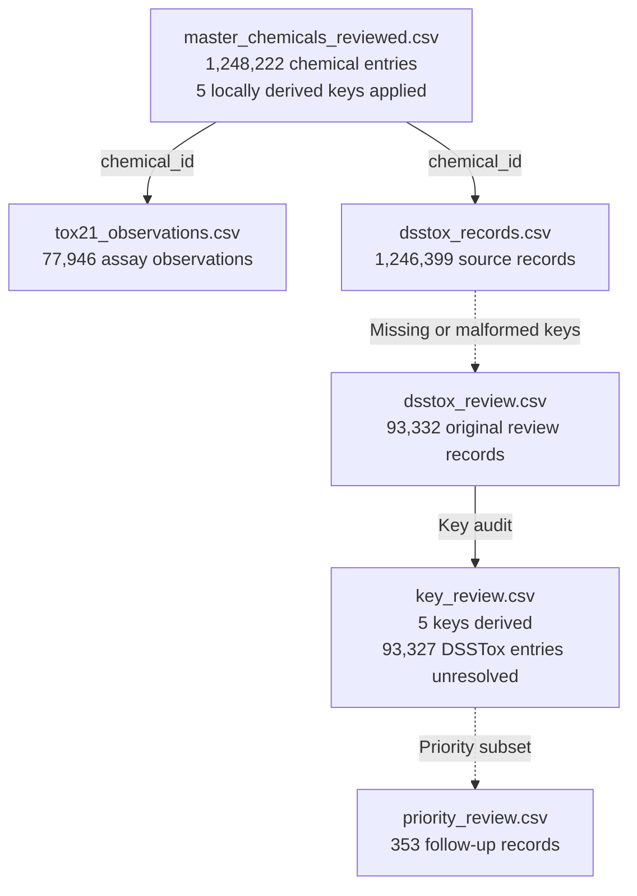

# ncem-toxicity

The pilot combines Tox21 assay results with EPA DSSTox chemical records in CSV files. Planned work adds ChEMBL, TOXRIC, and an AI retrieval tool using directed acyclic graph (DAG) links between compounds, assays, targets, and toxicity endpoints.

## What is in MasterChemCSV?

The current master is `tox21_key_review/master_chemicals_reviewed.csv`. The original import remains in `tox21_dsstox_complete/`. Each row represents a chemical identity or a provisional entry awaiting structure review.

The master has **24 columns**, listed below in CSV order.

| Group | Count | Column names |
| --- | ---: | --- |
| Internal identity and structure | 4 | `chemical_id`, `standard_inchikey`, `representative_smiles`, `identity_status` |
| Nuclear receptor assays | 7 | `NR-AR`, `NR-AR-LBD`, `NR-AhR`, `NR-Aromatase`, `NR-ER`, `NR-ER-LBD`, `NR-PPAR-gamma` |
| Stress response assays | 5 | `SR-ARE`, `SR-ATAD5`, `SR-HSE`, `SR-MMP`, `SR-p53` |
| DSSTox names and identifiers | 5 | `dsstox_inchikey`, `dsstox_preferred_name`, `dsstox_casrn`, `dsstox_dtxsid`, `dsstox_dtxcid` |
| DSSTox formula and masses | 3 | `dsstox_molecular_formula`, `dsstox_average_mass`, `dsstox_monoisotopic_mass` |

A nonstandard DSSTox InChIKey stays in `dsstox_inchikey`.

An assay is a lab test of a particular response. `1` means active, `0` means inactive, a blank means no result, and `conflict` means the source observations disagree. Activity is specific to the assay and its conditions.

For example, chemical ID `94c966d3-e7b1-56b4-9e8c-757804e199c7` has `conflict` in `NR-ER`: source record `TOX4994` reports `1`, while `TOX6178` reports `0`. Both remain in `tox21_observations.csv`.

## How the CSV files connect



Use `chemical_id` to look up observations and source records. The companion CSVs remain in `tox21_dsstox_complete/`; review outputs are in `tox21_key_review/`. Review rows are already included in `dsstox_records.csv`. The import and review manifests record fingerprints, policy versions, and counts.

### Companion CSV columns

| File | Count | Column names |
| --- | ---: | --- |
| `tox21_observations.csv` | 7 | `chemical_id`, `source_dataset`, `source_record_id`, `source_smiles`, `source_sha256`, `endpoint`, `result` |
| `dsstox_records.csv` | 16 | `chemical_id`, `source_row_number`, `source_sha256`, `DTXSID`, `PREFERRED_NAME`, `CASRN`, `DTXCID`, `INCHIKEY`, `IUPAC_NAME`, `SMILES`, `MOLECULAR_FORMULA`, `AVERAGE_MASS`, `MONOISOTOPIC_MASS`, `QSAR_READY_SMILES`, `MS_READY_SMILES`, `IDENTIFIER` |
| `dsstox_review.csv` | 17 | `review_reason`, followed by all 16 columns from `dsstox_records.csv` in the same order. |

## Data sources and matching keys

| Input | What it contributes | How records are matched |
| --- | --- | --- |
| `tox21.csv` | Chemical structures and results for 12 assays | RDKit generates a full Standard InChIKey from each SMILES string. Rows with the same full key share a `chemical_id`. The original `mol_id` stays in the observations as the source record ID. |
| EPA `DSSToxCCDdump.csv` | Chemical identifiers, names, structures, and properties | An exact match on the full supplied InChIKey reuses the Tox21 `chemical_id`. Records with new keys add master rows. |

An InChIKey is an identifier derived from a chemical structure. Names and CAS numbers remain metadata. For a missing or unusable DSSTox key, the importer checks whether the substance ID (`DTXSID`) points to exactly one usable key in the same export. All records with missing or malformed keys enter the review queue; unresolved records receive provisional IDs.

Use the full `DSSToxCCDdump.csv` inside `DSSTox_CCD_dump_12092025_CSVs.zip`. The numbered CSVs are partitions of that file. If the historical archive is unavailable through EPA, ask the lab for its archived copy. [Tox21 Data Challenge](https://tripod.nih.gov/tox21/challenge/data.jsp) · [EPA computational toxicology downloads](https://www.epa.gov/comptox-tools/downloadable-computational-toxicology-data)

| Input | SHA-256 fingerprint |
| --- | --- |
| `tox21.csv` | `7d7e7facd853a63e79ddce4e9c3fcb7a0d83a1c300b603031c0f2c64fbe77761` |
| `DSSToxCCDdump.csv` | `e69f56b35ce9d626810c6df2b5c79c48d0c3bb50ccde399da30687c6dd6d6a1b` |

## Set up and build

Use **Python 3.11 or later**. The Tox21 builder and key-review script require RDKit; the recorded review used **RDKit 2026.09.1**. Check the version loaded by your interpreter:

```bash
python3 -c "from rdkit import rdBase; print(rdBase.rdkitVersion)"
```

If the import fails, install RDKit in that environment. [RDKit installation guide](https://www.rdkit.org/docs/Install.html)

Place `tox21.csv` and the extracted `DSSToxCCDdump.csv` alongside the scripts. Allow several GB of free space for inputs, outputs, and temporary staging. Run from the repository root, using fresh output directory names:

```bash
python3 build_tox21.py tox21.csv tox21_initial
python3 import_dsstox.py tox21_initial DSSToxCCDdump.csv tox21_dsstox_complete
```

The first command creates the Tox21-only snapshot. The second adds DSSTox, using temporary SQLite staging, and writes the combined CSVs and import manifest.

## Combined output files

| File in `tox21_dsstox_complete/` | What it contains |
| --- | --- |
| `master_chemicals.csv` | Chemical catalog with selected DSSTox properties and Tox21 assay columns. |
| `tox21_observations.csv` | Individual Tox21 results with source record IDs, original SMILES, and the source fingerprint. |
| `dsstox_records.csv` | All linked DSSTox records, including all 13 original fields, source row numbers, and the source fingerprint. |
| `dsstox_review.csv` | Records with missing or malformed keys, with a review reason and a link to the master. |
| `dsstox_import.json` | DSSTox input fingerprint, import policy version, and counts. |

## Review missing DSSTox keys

Run the optional review into a new output directory:

```bash
python3 review_dsstox_keys.py tox21_dsstox_complete tox21_key_review
```

The reviewed master includes **5 locally derived keys**, marked `key_derived_from_source_smiles`, with all chemical IDs preserved. **93,327 DSSTox entries remain unresolved**. `key_updates.csv` records the changes, `key_review.csv` contains the full audit, and `priority_review.csv` holds **353 follow-up records**. Counts, hashes, and software versions are in `key_review_manifest.json`.

Keys are derived only from original explicit SMILES after formula and structure round-trip checks. Ambiguous structures and conversion warnings remain unresolved. Original DSSTox keys remain unchanged. [Review details](tox21_key_review/KEY_REVIEW.md)

## Expected counts and future imports

These counts apply to the inputs above and DSSTox import policy version **2**.

| Check | Expected count |
| --- | ---: |
| Original Tox21 input records | 7,831 |
| Tox21-only master rows | 7,829 |
| Tox21 observations | 77,946 |
| Linked DSSTox input records | 1,246,399 |
| Existing Tox21 identities matched by exact InChIKey | 6,006 |
| Combined and reviewed master rows | **1,248,222** |
| Provisional DSSTox entries before key review | 93,332 |
| Locally derived keys applied | 5 |
| Unresolved DSSTox entries after key review | 93,327 |
| Priority review records | 353 |

DSSTox expands the catalog. Tox21 supplies all current assay results: **7,829 of 1,248,222 rows (0.627%)** have at least one result. [Assay coverage graph](chemical-master-explorer.html) · [Chemical row graph](master-csv-points.html). Open the row graph and select `tox21_key_review/master_chemicals_reviewed.csv`.

For a new DSSTox release, rebuild from the Tox21-only snapshot into a fresh directory and check the new manifest. For other datasets, document the release and matching rule and retain observations with their source identifiers. Use a CSV-aware tool, such as Python's `csv` module, to filter the full master for browsing.
