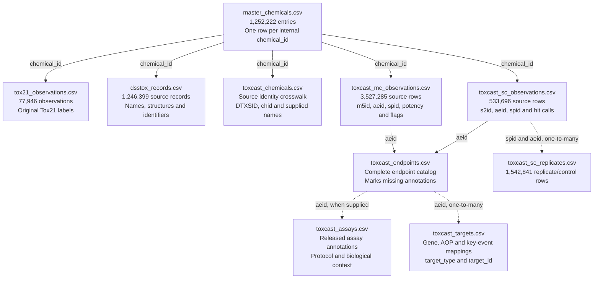

# ncem-toxicity

This project combines Tox21 assay results, EPA DSSTox chemical identities, and EPA ToxCast bioactivity data in traceable CSV files. ChEMBL ingestion, TOXRIC integration, and DAG-based agentic retrieval remain future work.

## What is in MasterChemCSV?

The current master is `tox21_dsstox_toxcast_v4_3/master_chemicals.csv`: **1,252,222 chemical/substance entries and 27 columns**. Each row represents an internal chemical identity or a substance-only entry awaiting structure resolution. The reviewed baseline remains in `tox21_key_review/master_chemicals_reviewed.csv`.

| Group | Count | Column names, in CSV order |
| --- | ---: | --- |
| Internal identity and structure | 4 | `chemical_id`, `standard_inchikey`, `representative_smiles`, `identity_status` |
| Nuclear receptor assays | 7 | `NR-AR`, `NR-AR-LBD`, `NR-AhR`, `NR-Aromatase`, `NR-ER`, `NR-ER-LBD`, `NR-PPAR-gamma` |
| Stress response assays | 5 | `SR-ARE`, `SR-ATAD5`, `SR-HSE`, `SR-MMP`, `SR-p53` |
| DSSTox names and identifiers | 5 | `dsstox_inchikey`, `dsstox_preferred_name`, `dsstox_casrn`, `dsstox_dtxsid`, `dsstox_dtxcid` |
| DSSTox formula and masses | 3 | `dsstox_molecular_formula`, `dsstox_average_mass`, `dsstox_monoisotopic_mass` |
| ToxCast coverage counts | 3 | `toxcast_mc_result_count`, `toxcast_sc_result_count`, `toxcast_endpoint_count` |

The 12 Tox21 columns use `1` for active, `0` for inactive, blank for no available result, and `conflict` for disagreement between source observations. These labels are specific to each assay. A nonstandard DSSTox InChIKey stays in `dsstox_inchikey`.

The three ToxCast columns count distinct MC results (`m5id`), SC results (`s2id`), and assay endpoints (`aeid`) linked to each chemical. MC means multiple-concentration screening; SC means single-concentration screening. **A zero count means no linked result, not an inactive or safe chemical.** Detailed measurements, units, and flags are in the companion CSVs.

## How the CSV files connect

The files below are inside **`tox21_dsstox_toxcast_v4_3/`**. Arrows show lookup keys between files. They do not represent biological causation or imply that every master entry has a result in every source.



| Lookup | Key | What to expect |
| --- | --- | --- |
| Master → observations, DSSTox records, or ToxCast identity crosswalk | `chemical_id` | One master entry can have many source records and results. `source_record_id` identifies an original Tox21 record. |
| ToxCast result → complete endpoint catalog → assay context | `aeid` | The catalog includes endpoints with missing annotations; available context describes the assay, organism, tissue, and response. |
| Endpoint → targets | `aeid` | Zero or more mappings. Keep `target_type` with `target_id` to distinguish genes, adverse outcome pathways (AOPs), and key events. |
| SC summary → SC1 replicates/controls | `spid` **and** `aeid` | Multiple rows; these do not add processed-result coverage. |
| Distinct ToxCast results | MC: `m5id`; SC: `s2id` | These are native processing IDs. They are not chemical IDs. |

Use left joins when preserving the chemical catalog or observations. An endpoint can map to several targets, so a join can expand the row count. **Count distinct processing IDs and chemical IDs, not joined rows.** Rows with blank `chemical_id` remain in the source tables and review queue; never match blank IDs to one another.

Seventeen endpoints lack rows in the released annotations. Their observations remain in the data; `toxcast_endpoints.csv` marks the gap and `toxcast_assay_review.csv` gives source examples. No target or protocol is inferred to fill it.

Quality information is in `toxcast_analytical_qc.csv`, `toxcast_cytotoxicity.csv`, and `quality/`; processing definitions are in `methods/`. Supplemental model outputs are under `derived/` and do not count as experimental coverage. See the [ToxCast guide](docs/toxcast-import.md) for the full output inventory and interpretation rules.

### Following an example

Filter MC observations by `chemical_id`, retain a result's `m5id`, `spid`, value, units, and flags, then look up `aeid` in the endpoint/annotation/target files. `trace_example.json` contains one complete example with its source file, logical row, and fingerprint.

For the original Tox21 conflict example, chemical `94c966d3-e7b1-56b4-9e8c-757804e199c7` has `conflict` in `NR-ER`. In `tox21_observations.csv`, source record `TOX4994` reports `1` and `TOX6178` reports `0`. Both observations are retained.

## Data sources and identity matching

| Input | Contribution | Import matching rule |
| --- | --- | --- |
| `tox21.csv` | Structures and labels for 12 endpoints. | Full Standard InChIKey generated from SMILES with RDKit; original `mol_id` retained for provenance. |
| EPA `DSSToxCCDdump.csv` | Chemical identities, structures, names, formulas, and masses. | Exact full supplied InChIKey reuses an existing `chemical_id`. New keys add rows; missing keys retain provisional identities. |
| EPA invitrodb v4.3 | ToxCast MC/SC results, assay/target annotations, quality information, and modeled supplements. | DTXSID must map unambiguously through all linked DSSTox source records. New valid DTXSIDs receive stable substance-only IDs. |

InChIKeys and DTXSIDs establish import matches; the resulting `chemical_id` links published chemical evidence. Native `chid` is an invitrodb identifier, not our internal ID. Names and CAS numbers are metadata, not merge keys. The ToxCast crosswalk may contain several supplied names or identities for one internal ID.

Use the full DSSTox export from `DSSTox_CCD_dump_12092025_CSVs.zip`; its numbered CSVs are partitions. The two original input fingerprints are:

| Input | SHA-256 |
| --- | --- |
| `tox21.csv` | `7d7e7facd853a63e79ddce4e9c3fcb7a0d83a1c300b603031c0f2c64fbe77761` |
| `DSSToxCCDdump.csv` | `e69f56b35ce9d626810c6df2b5c79c48d0c3bb50ccde399da30687c6dd6d6a1b` |

ToxCast release URLs, sizes, and hashes are pinned in [toxcast_sources.json](toxcast_sources.json). Source background: [Tox21 Data Challenge](https://tripod.nih.gov/tox21/challenge/data.jsp) and [EPA ToxCast downloads](https://www.epa.gov/comptox-tools/exploring-toxcast-data).

## Set up and build

Use Python 3.11 or later, with RDKit for the Tox21 builder/key review and the pinned Excel reader for ToxCast. The recorded key review used RDKit 2026.09.1. [RDKit installation guide](https://www.rdkit.org/docs/Install.html)

```bash
python3 -c "from rdkit import rdBase; print(rdBase.rdkitVersion)"
python3 -m pip install -r requirements/toxcast.txt
```

Run from the repository root with `tox21.csv` and the extracted `DSSToxCCDdump.csv` beside the scripts. **Every build requires a fresh output directory.** These commands reflect the actual current layout; the Tox21 builder is named `BuiltMasterTox21.py`.

```bash
python3 BuiltMasterTox21.py tox21.csv tox21_initial
python3 import_dsstox.py tox21_initial DSSToxCCDdump.csv tox21_dsstox_complete
python3 review_dsstox_keys.py tox21_dsstox_complete tox21_key_review
python3 download_toxcast.py --source-dir sources/toxcast/invitrodb_v4_3
python3 import_toxcast.py \
  --base-snapshot tox21_dsstox_complete \
  --key-review tox21_key_review \
  --source-dir sources/toxcast/invitrodb_v4_3 \
  --output tox21_dsstox_toxcast_v4_3
```

Allow roughly 25 GB of free space for downloaded inputs, a new snapshot, and staging; a parallel full rebuild needs more. SQLite is temporary build workspace. Durable outputs are CSVs and JSON manifests. [Detailed rebuild and verification guide](docs/toxcast-import.md)

## Review queues and validation

The original DSSTox import has 93,332 missing-key review records. The reviewed baseline applied **5 locally derived keys**, preserving IDs and original DSSTox keys, leaving **93,327 unresolved entries** and a **353-record priority queue**. Audit files remain in `tox21_key_review/`; copies are under `key_review/` in the current snapshot. `dsstox_review.csv` is a subset of `dsstox_records.csv`, not additional chemical evidence.

ToxCast identity/call issues are in `toxcast_review.csv`; assay annotation gaps are in `toxcast_assay_review.csv`. The 4,000 added substance entries have no interpretable experimental results in this import and receive no inferred structures.

| Snapshot measure | Count |
| --- | ---: |
| Reviewed Tox21 + DSSTox baseline entries | 1,248,222 |
| Current master entries | **1,252,222** |
| Original Tox21 observations | 77,946 |
| Distinct ToxCast MC + SC results | **4,060,981** |
| Existing chemicals newly gaining interpretable results | **4,519** |
| Original catalog entries covered after import | **12,348 (0.9892%)** |
| Unresolved ToxCast processed results retained | 10,415 |

Full rebuilds produced byte-identical outputs. A separate calculation reconciled native result IDs, original master values, reviewed keys, endpoint/target references, and coverage. The [validation certificate](reports/toxcast/validation.json) records these automated integrity checks; scientific interpretation still requires researcher review.

ToxCast contains Tox21-origin assays, so overlapping data is not automatically independent evidence. Quality flags remain visible. MC potency units can be uM, CF, or unknown; modeled doses and cytotoxicity defaults remain distinguishable from measured assay results.

For future imports, build a new snapshot, document the release and matching rule, retain source observations, and reconcile counts and fingerprints. Large downloads and generated snapshots stay Git-ignored; source code, tests, dependency pins, source locks, and curated validation evidence remain versioned.
